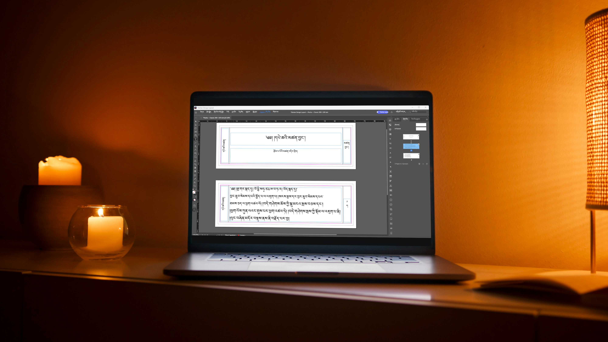
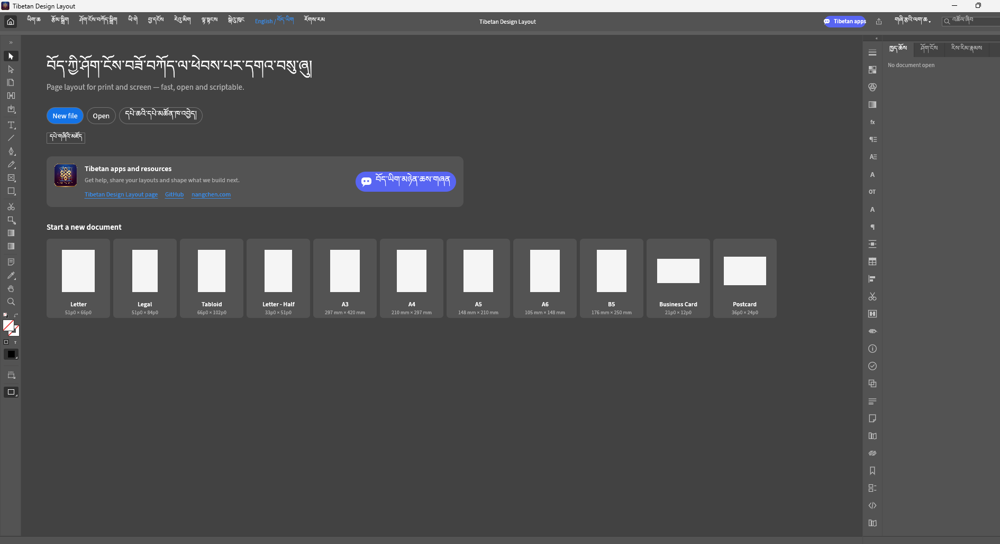
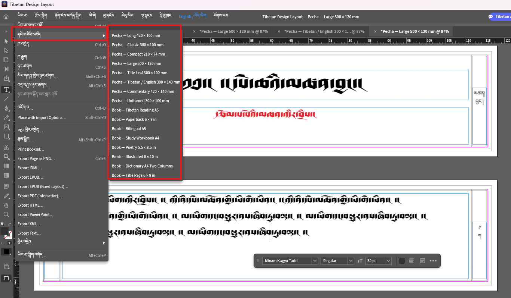
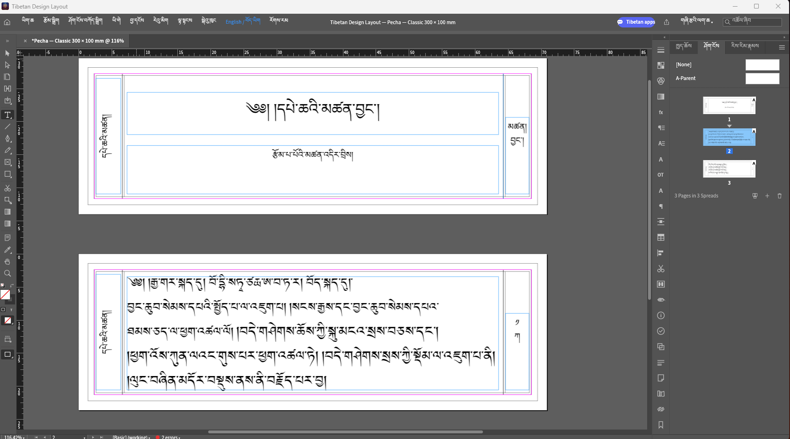
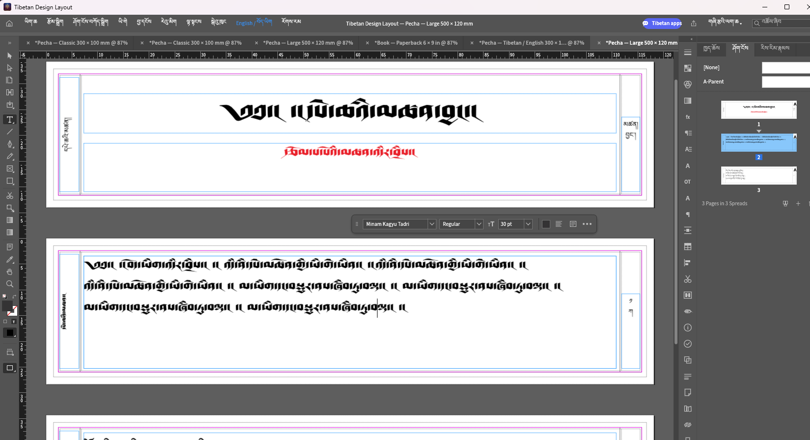
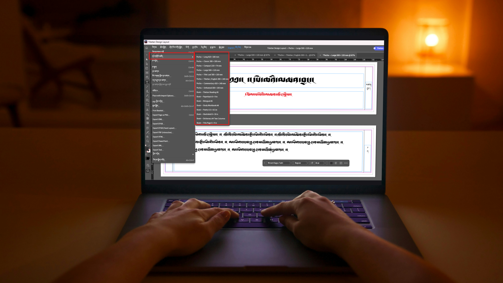

# Tibetan Design Layout

**བོད་ཀྱི་ཤོག་ངོས་བཟོ་བཀོད།**

Free page layout and publishing software for Tibetan and English. Create Pecha texts, books and print-ready page layouts with editable text and image frames, styles, tables and PDF export.

Created by **ནང་ཆེན་བཀྲ་ཤིས།**.

[Download for Windows and Mac](https://github.com/tibetanebook-cloud/tibetan-design-layout/releases/latest) · [All releases](https://github.com/tibetanebook-cloud/tibetan-design-layout/releases)

## Tibetan and English

Use the visible **English / བོད་ཡིག** menu beside **Help** to switch interface languages. Tibetan menus and common controls are translated; some controls remain English. Packaged builds include Noto Serif Tibetan. You can also use compatible fonts installed on your computer.

## Pecha and book template library

Choose **File → Template Library** for **8 Pecha and 8 book templates**. Start with classic, long, compact, large, bilingual, commentary, title-leaf or unframed Pecha layouts. Book options include Tibetan reading, paperback, bilingual, workbook, poetry, illustrated, dictionary and title-page layouts.

Frames, borders and text remain editable. Folio labels require manual editing; these are starting layouts, not automatic book imposition. See the [template guide](docs/tibetan-templates.md).

### Classic Pecha

### Large Pecha and Tibetan typography

## Downloads and updates

Windows packages include an x64 MSI installer and portable ZIP. Mac packages are separate DMGs for Apple Silicon and Intel. Open the latest release above and select the package for your computer. A release appears only after its required builds pass.

Version 0.8.2 adds optional automatic checks for new releases and **Help → Check for Updates**. Update notifications open the download page; they do not silently install software.

Packages are currently unsigned on Windows and ad-hoc signed on Mac, without Apple notarization.

## More Tibetan applications

[Nangchen.com](https://nangchen.com) · [StudyTibetan.com](https://studytibetan.com) · [TibetanEbook.com](https://tibetanebook.com)

## Development and credits

Prepare fonts with `scripts/prepare-tibetan-font.ps1` or `scripts/prepare-tibetan-font.sh`, then build with Cargo. Packaging scripts are in `packaging/windows` and `packaging/macos`.

Based on [DesignCraft](https://github.com/storytold/designcraft), copyright its original authors. Original code remains MIT OR Apache-2.0; see LICENSE-MIT, LICENSE-APACHE and NOTICE. Original contributor credits and compatibility identifiers are retained. User-supplied branding and screenshots have no separate public asset license asserted. Noto Serif Tibetan uses SIL OFL 1.1. See [asset provenance](ASSETS.md).
